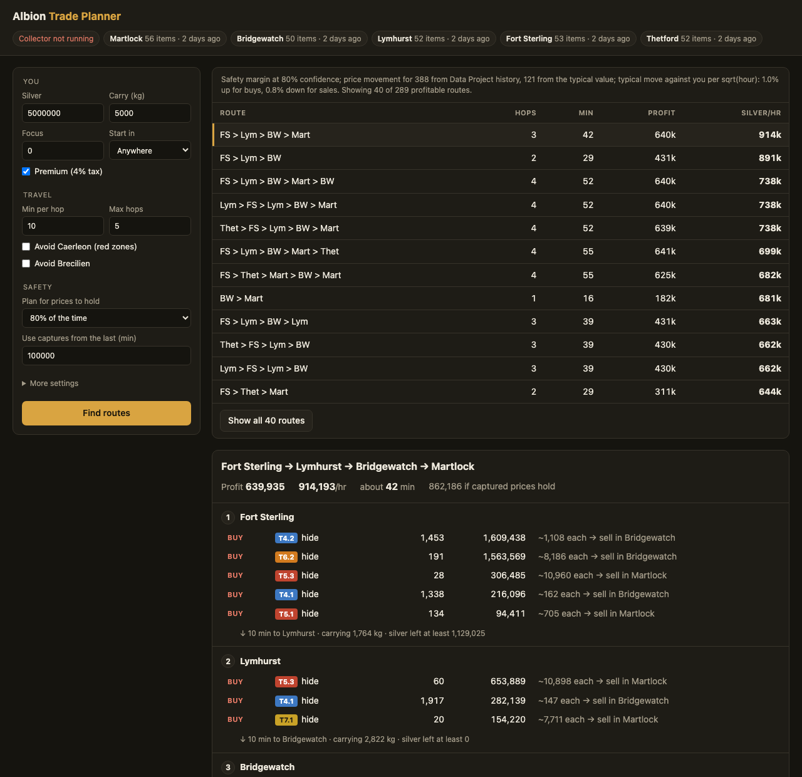

# Albion Trade Planner

A free, community-made trade route planner for Albion Online. It plans transport and refining runs between the cities from the market pages you open in-game.

**TL;DR:** Run the [Albion Data Client](https://github.com/ao-data/albiondata-client) pointed at the tiny local collector here, and open some markets in-game. Then start `python3 ui.py` and pick your silver, carry weight and focus. You get the best routes ranked by silver per hour, with exactly what to buy, refine and sell at each stop. Prices get a safety margin for how much they usually move before you arrive. It's Python with no extra packages, runs only on your own computer, and is free for everyone, forever.



<sub>Screenshot from captures spread over a couple of days, so the numbers only show the layout. There's also a [light version](docs/planner-light.png).</sub>

## A gift to the community

This is a community project, and nobody makes money from it: no paywall, no premium tier, no ads, no account. The license ([PolyForm Noncommercial](LICENSE)) lets anyone use, share and change it, but not sell it or use it commercially.

The only official source is this repository. There are no .exe downloads or installers, and there never will be. If someone offers you an "improved" build to download, don't run it.

## What it does

- **Uses the real order lists.** The Data Project API only gives the best price per item and city. The Data Client sees every order on the market pages you open, and the collector saves them all. So a trade is priced by working down the actual orders: if there are 12 hides at the best price and the next 300 cost 20% more, the plan knows.
- **Plans whole routes.** At each stop it sells what you brought for that city, then buys what sells for more further along, so each stop's sales pay for the next buys. It works within your silver, your carry weight on every leg, and your focus. All trades on a route share the same order lists, so one order is never counted twice.
- **Refines on the way.** All five refining families, T4–T8 and every enchant level the game has: bars in Thetford, leather in Martlock, planks in Fort Sterling, cloth in Lymhurst, stone blocks in Bridgewatch. With or without focus.
- **Covers every city with a market.** That's the five Royal Cities, plus Caerleon and Brecilien once you've captured them. Routes through Caerleon are marked as red zone (full loot), and you can avoid any city.
- **Adds a safety margin for stale prices.** By the time you reach stop 3, the prices you captured there are older. Each price is moved against you by how much that market usually moves in that time (see [How it plans](#how-it-plans)).
- **Ranks by silver per hour.** It counts travel time per hop and trading time per stop, so a short route can beat a long one.

## Getting started

You need Python 3 and nothing else; there are no packages to install. Tested with Python 3.13 on macOS and the Europe server.

1. Clone this repo.
2. Download the Albion Data Client from its [releases page](https://github.com/ao-data/albiondata-client/releases) and unzip it into `tools/albiondata-client/`. If you keep it somewhere else, set `ALBION_CLIENT=/path/to/client`.
3. Start the collector and the client:
   ```
   ./start-collector.sh
   ```
   The client asks for your password because it reads the game's network traffic. The scripts here never need it.
4. In-game, walk through a door once so the client picks up your location. Then open the markets for the items you care about in each city. The Buy tab shows sell orders and the Sell tab shows buy orders.
5. Open the planner:
   ```
   python3 ui.py
   ```
   It opens `http://127.0.0.1:8767` in your browser. You can put settings in the link, e.g. `http://127.0.0.1:8767/?focus=30000&max_age=120&run=1`, and bookmark it.

On Windows (untested), run `python collector.py` in one window and the data client as admin with `-i http://127.0.0.1:8766` in another, then `python ui.py`. The client's own README covers what it needs on Windows.

### Command line

Everything in the UI also works from the terminal, plus a few extras:

```
python3 loop.py --silver 5000000 --kg 5000 --focus 30000   # best routes, and the plan for the top one
python3 loop.py --from Bridgewatch                         # only routes starting in Bridgewatch
python3 loop.py --route FS Lym BW Mart                     # plan one route you pick (short names work)
python3 loop.py --avoid Caerleon --confidence 0.9          # skip red zones, bigger safety margin
python3 loop.py --hop-min 8 --caerleon-min 12              # your own travel times
python3 loop.py --orders --days 1 --share 0.2              # also plan listing sell orders
python3 trip.py --silver 5000000 --kg 5000                 # best single trip
python3 refine.py --tier 6 7 --enchant 0 1                 # refining from public prices only
python3 collector.py status                                # what you've captured
```

Every script takes `-h` for the full list of options.

## How it plans

**Trades.** The planner is greedy, not a perfect solver. It keeps taking the most profitable batch of trades for the silver, weight and focus that batch uses, then re-prices everything that shares orders with it. It tries a few different balances of silver, weight and focus, and keeps the plan that ends with the most silver. By default it only plans instant trades (buy from sell orders, sell into buy orders), because those are the prices you can count on. With `--orders` it can also plan listing sell orders, capped at a share of that city's daily sales from the Data Project's 7-day history.

**Travel.** Neighbouring Royal Cities are one hop apart (`--hop-min`, default 10 minutes). Caerleon and Brecilien are one hop from every Royal City, with their own times (`--caerleon-min`, `--brecilien-min`). How you get to Brecilien is up to you, and fast-travel fees aren't counted. Each route can visit Caerleon and Brecilien at most once, which keeps the number of routes to check reasonable. With both cities captured, it checks about 7,000 routes in around half a minute.

**Safety margin.** A price captured some time ago can have moved by the time you arrive. For every order list, `drift.py` looks at how its price moved over past intervals, scaled to one hour (a move over t hours counts as move / √t, as for a random walk). It then takes the move against you that was beaten only 1 time in 5 (at the default `--confidence 0.8`). A buy is planned at that much higher, and a sale at that much lower, scaled by √(hours since you captured it + hours until you get there). The past moves come from:

1. your own repeated looks at the same market (the collector records every sighting, so this gets better the more you play),
2. otherwise the Data Project's hourly average traded prices (downloaded, never uploaded),
3. otherwise the typical move of all the other order lists.

Routes are ranked on these cautious prices, and each plan also shows the profit if captured prices hold. Use `--confidence 0.9` or `0.95` for a bigger margin, or `0.5` to turn it off. The margin covers prices drifting. It can't know when someone buys out a whole order before you get there, so reopen each market before you trade.

**Game numbers.** These come from the game's own data files ([ao-bin-dumps](https://github.com/ao-data/ao-bin-dumps)):

| Number | Value | Where |
|---|---|---|
| Recipes, item values, focus costs, weights | | `items.xml` |
| Enchanted versions | .1–.4, none for stone blocks | `items.xml` |
| Royal City refining bonus | 18% | `craftingmodifiers.xml` (`refiningbonus`) |
| Bonus city (ore Thetford, hide Martlock, wood Fort Sterling, fiber Lymhurst, stone Bridgewatch) | +40% | `craftingmodifiers.xml` (`craftingmodifier`) |
| Focus bonus | +59% | `gamedata.xml` (`ActionFocus` / `CraftingEfficiency`) |
| Sales tax without premium | 8% | `gamedata.xml` (`MarketPlace` / `transactiontax`) |
| Setup fee on orders | 2.5% | `gamedata.xml` (`MarketPlace` / `setupfee`) |
| Station nutrition per item value | 0.1125 | `gamedata.xml` (`ItemValueToNutrition`) |

With premium the sales tax is 4%. Return rates come from the bonuses as `bonus / (1 + bonus)`: 36.7% in the bonus city without focus, 53.9% with focus.

## What it touches

You should be able to check this yourself, so here's the full list:

- **Internet:** only GET requests to the Data Project API (`albion-online-data.com`) for prices and history. They all go through `get_json` in `refine.py`, which calls curl. Nothing gets uploaded.
- **Network:** the collector listens on `127.0.0.1:8766` and the UI on `127.0.0.1:8767`, so other machines can't reach them. The UI also refuses requests that don't come from a page opened at 127.0.0.1 or localhost, so other websites can't talk to it.
- **Files:** it writes `market.db` and `.cache/` in this folder, and reads the data client's log here to see which city you're in. It deletes only its own old data: sightings older than 30 days, and cached downloads when you run `refine.py --fresh`.
- **Your browser:** `ui.py` opens its own page once when it starts (use `--no-open` to skip that).
- **sudo:** only the data client needs it. None of the scripts in this repo do.
- **The game:** it doesn't read game memory, click anything or automate anything. You still do all the trading yourself.

It's about 2,100 lines of plain Python using only the standard library. To see every line that touches the network, files or other programs (about two dozen):

```
grep -nE "curl|subprocess|socket|webbrowser|HTTPServer\(|open\(|unlink|DELETE|sudo|https?://" *.py *.sh
```

## Is this allowed?

Honest answer: it's tolerated, not officially allowed, so use it at your own risk.

- **The written rules:** Albion's [Terms and Conditions](https://albiononline.com/terms_and_conditions), §13.3 "No Manipulation", forbid "software enabling 'data mining' or which intercepts or captures data" in connection with the game. Read literally, that covers the Albion Data Client, which every Data Project tool depends on.
- **What SBI staff have said:** in 2017, the game's technical lead said "as long as you just look and analyze we are ok with it", and that they'd act against anything that modifies or interferes with the game ([quoted by the client](https://github.com/ao-data/albiondata-client)). In January 2025, the then Community Manager said Data Project tools are permitted and not officially supported, but only as long as they stay free and don't put features behind a paywall ([forum thread](https://forum.albiononline.com/index.php/Thread/206875-Albion-Market-API-Encryption/?postID=1409736#post1409736)).
- **What support has reportedly said:** in the same thread, a player posted a December 2025 reply from customer service saying third-party programs are "strictly prohibited… at your own risk". That's secondhand, but it's the most recent word.

The scripts in this repo don't intercept anything themselves. The gray area is the Data Client. If you want to stay fully clear of it, `refine.py` works from public Data Project prices alone, plus prices you type in with `--set`.

## About uploads

`start-collector.sh` runs the client with `-i http://127.0.0.1:8766`, which replaces its upload target, so your captures stay on your machine and don't go to the Data Project. The price history that the safety margin, `--orders` and `refine.py` use comes from the Data Project, though, and that only exists because people upload. If you want to keep contributing, the client's help says `-i` takes a comma-separated list, so `-i https+pow://albion-online-data.com,http://127.0.0.1:8766` should send to both. I haven't tested that.

Two gotchas on client 0.1.61: `-i noop` crashes on the first upload, and `-d` turns off every upload, including the local one.

## Ideas and contributing

Issues and pull requests are welcome. Some ideas:

- **Other servers.** The API host in `refine.py` (`HOST`) points at Europe. A `--server` option would be easy.
- **Brecilien travel costs.** Fast-travel fees depend on what you carry, and they aren't counted yet.
- **Planning buy orders,** not just instant buys.
- **Black Market gear flips.** That would be a bigger change, since it's gear, not resources.
- **A Windows launcher** like `start-collector.sh`.
- **Tests.**

If a number looks wrong, or the game data changes after a patch, please open an issue. Contributions are accepted under the same license, so the project stays free for everyone.

## License

[PolyForm Noncommercial 1.0.0](LICENSE): free to use, share and change for any noncommercial purpose, including playing the game. Not for selling or commercial use. This project isn't affiliated with Sandbox Interactive or the Albion Online Data Project.
